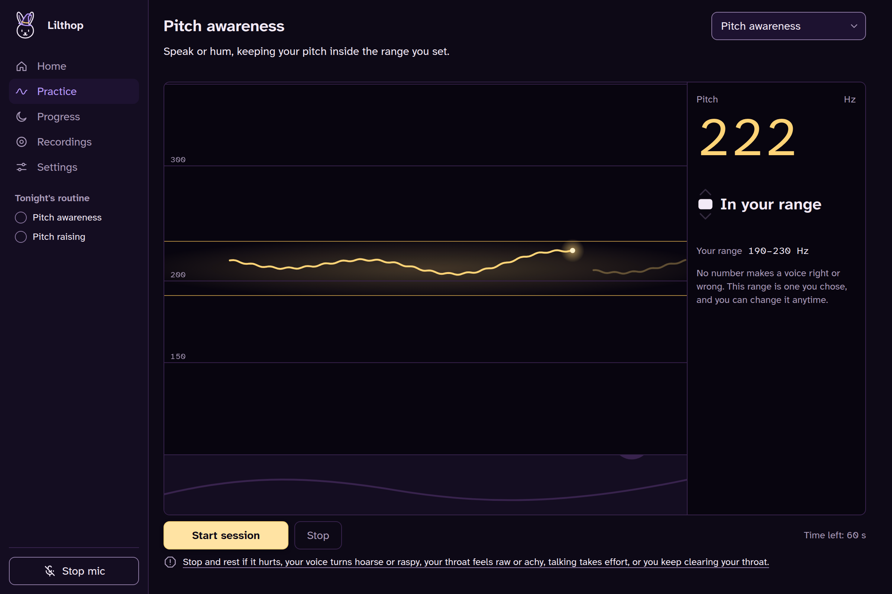
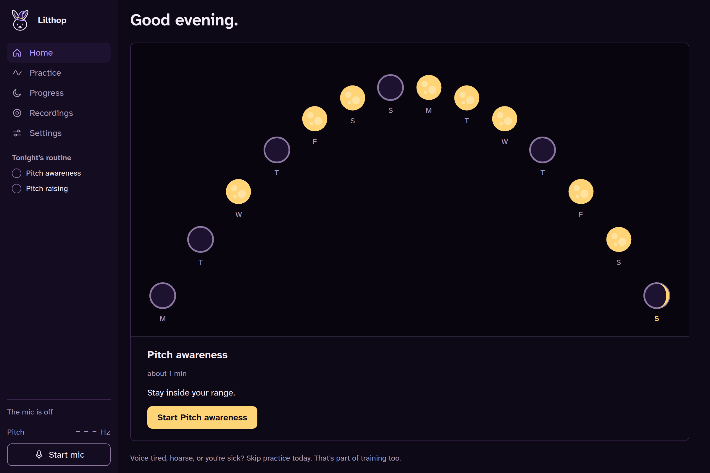

<p align="center">
  <picture>
    <source media="(prefers-color-scheme: dark)" srcset="docs/brand/lilthop-logo-dark.svg">
    
  </picture>
</p>

**A free desktop app for practicing your voice on your own.**

- Made for trans women and transfeminine people working toward a higher, more feminine voice.
- Shows your pitch live against a range you pick.
- Walks you through short exercises.
- Keeps your recordings and progress on your computer.
- In English and Spanish.

New to voice training? Welcome. Please read [Read this first](#read-this-first) before you start practicing.

## Download

Version 0.1.0, for [Windows, Linux and macOS](https://github.com/WitchyNibbles/lilthop/releases/tag/v0.1.0).

| System  | Download                                                                                                                                                                                                                                                                                                                                                         |
| ------- | ---------------------------------------------------------------------------------------------------------------------------------------------------------------------------------------------------------------------------------------------------------------------------------------------------------------------------------------------------------------- |
| Windows | [`Lilthop_0.1.0_x64-setup.exe`](https://github.com/WitchyNibbles/lilthop/releases/download/v0.1.0/Lilthop_0.1.0_x64-setup.exe), or the [`.msi`](https://github.com/WitchyNibbles/lilthop/releases/download/v0.1.0/Lilthop_0.1.0_x64_en-US.msi) if you prefer that                                                                                                |
| Linux   | [`.AppImage`](https://github.com/WitchyNibbles/lilthop/releases/download/v0.1.0/Lilthop_0.1.0_amd64.AppImage), [`.deb`](https://github.com/WitchyNibbles/lilthop/releases/download/v0.1.0/Lilthop_0.1.0_amd64.deb) (Debian, Ubuntu) or [`.rpm`](https://github.com/WitchyNibbles/lilthop/releases/download/v0.1.0/Lilthop-0.1.0-1.x86_64.rpm) (Fedora, openSUSE) |
| macOS   | [`Lilthop_0.1.0_universal.dmg`](https://github.com/WitchyNibbles/lilthop/releases/download/v0.1.0/Lilthop_0.1.0_universal.dmg), one build for Apple Silicon and Intel                                                                                                                                                                                            |

The builds are unsigned, so your computer warns you the first time. [Install](#install) says how to get past that.

## Read this first

Lilthop is a practice tool. It is not a therapist.

- It hears sound. It can't feel your throat.
- It measures pitch, level and a rough brightness.
- It can't tell if you're straining, tired or hurt.
- No voice therapist or doctor made or checked it.
- No one is on hand to help.
- It doesn't replace a voice therapist.
- The sources we read recommend a professional check before practicing on your own. If you can get one, do.
- **If it hurts, stop.**

It has only been tested on one voice. The automated tests use synthetic signals. Real-voice testing so far is the owner's own voice only.

The sources behind the app's safety text are in [`docs/research/voice-safety.md`](docs/research/voice-safety.md). No clinician has reviewed that text yet.

### En español

- La app oye el sonido, pero no siente tu garganta.
- Mide el tono, el volumen y un brillo aproximado.
- No puede saber si estás forzando, si tienes la voz cansada o si te haces daño.
- No la hizo ni la revisó nadie de terapia de voz ni de medicina.
- No hay nadie para ayudarte.
- No sustituye a la terapia de voz.
- Las fuentes que leímos recomiendan una revisión profesional antes de practicar por tu cuenta. Si puedes, hazla.
- **Si te duele, detente.**

Solo se ha probado con una voz. Las pruebas automáticas usan señales sintéticas, y las pruebas con voz real son, por ahora, solo con la voz de la persona que hizo la app.

Las fuentes del texto de seguridad de la app están en [`docs/research/voice-safety.md`](docs/research/voice-safety.md). Ninguna persona profesional ha revisado todavía ese texto.

## Screenshots

The data in these is made up.





## Install

### Windows

1. Run the `.exe` (or the `.msi`).
2. SmartScreen says "Windows protected your PC".
3. Click More info, then Run anyway.

### Linux

- `.AppImage`: runs anywhere.
- `.deb`: Debian, Ubuntu.
- `.rpm`: Fedora, openSUSE.

### macOS

1. Open the `.dmg`. It is one universal build for Apple Silicon and Intel. You can ignore the `.app.tar.gz`.
2. macOS says the app "cannot be opened" or "is damaged".
3. Right-click the app and choose Open.
4. Or open System Settings, then Privacy & Security, and click Open Anyway.
5. Still "is damaged"? This command in Terminal clears the download flag:

```sh
xattr -dr com.apple.quarantine /Applications/Lilthop.app
```

### Why the warning

Signing costs money, so for now the builds are unsigned. GitHub builds the files from the public code.

### Something broke

Tell us in [issues](https://github.com/WitchyNibbles/lilthop/issues). Please don't attach real recordings or personal details.

## Privacy

Nothing leaves your computer.

- No account.
- No telemetry.
- No network calls.
- No remote fonts or images.
- The content security policy blocks outside connections.
- The webview never sees a file path.
- Settings has backup, export and a real delete-everything button.

Your data lives in the app's data folder:

| System  | Folder                                                    |
| ------- | --------------------------------------------------------- |
| Windows | `%APPDATA%\com.witchynibbles.lilthop`                     |
| Linux   | `$XDG_DATA_HOME/com.witchynibbles.lilthop`                |
| macOS   | `~/Library/Application Support/com.witchynibbles.lilthop` |

### The old Voice Trainer folder

The app used to be called Voice Trainer (`com.voice.trainer`).

- On first start, Lilthop copies that folder's database and recordings over.
- It checks the copy.
- It leaves the old folder as it was.
- If the copy fails, the app says so and offers a retry instead of starting empty.
- Lilthop only reads that folder if its database really is this app's.
- "Delete all data" removes the app's own files from the old folders too, and leaves anything else that is in them.

## Run it from source

You need:

- Node 22.22.2 or newer on 22, 24.15 or newer on 24, or 26 and up (the `engines` field in `package.json`; the test tools ask for exactly that).
- Rust stable.
- The [Tauri prerequisites](https://tauri.app/start/prerequisites/) for your system.

Summon the dev window:

```sh
npm ci
npm run tauri dev
```

Build a release:

```sh
npm run tauri build
```

## Check it

You need Python 3.11 or newer. The full check also needs [uv](https://docs.astral.sh/uv/), because it runs `diff-cover` through `uvx`.

```sh
python3 .grimoire/check.py full --base "$(git merge-base HEAD main)"
cd src-tauri && cargo fmt --check && cargo clippy --all-targets -- -D warnings && cargo test
```

See how far behind the mic the pitch trace runs (dev builds):

1. In the webview console, run `localStorage["lilthop-timing"] = "1"`.
2. Reload.
3. The console now prints a timing line.

Compare the pitch reading on a real recording with a tuner:

```sh
cd src-tauri && cargo run --example analyze path/to/file.wav
```

## How it's put together

- `src-tauri/src/dsp`: pitch (YIN) and brightness, pure functions with known-answer tests.
- `src-tauri/src/audio`: capture, recorder, playback, each on its own thread.
- `src-tauri/src/storage`: SQLite, backup and restore, export.
- `src/domain`: what the numbers mean. Pitch smoothing for display, sessions, scoring, safety notices, stats. No React.
- `src/live`, `src/practice`, `src/home` and friends: the UI.
- `docs/plans/2026-11-06-fix-and-redesign.md`: the IPC contract and the plan.
- `docs/going-public.md`: the release checklist (what's done, what's still open) and the steps for the first commit.

## Contribute

Small changes are welcome. Say what they're for.

- [`CONTRIBUTING.md`](CONTRIBUTING.md): how to build, run the checks and keep both languages in step.
- [`CODE_OF_CONDUCT.md`](CODE_OF_CONDUCT.md): how we treat each other.

## Licence

GPL-3.0-or-later, see [`LICENSE`](LICENSE).

Third-party licences are in [`THIRD-PARTY-NOTICES.md`](THIRD-PARTY-NOTICES.md). `npm run notices` rebuilds it.

Happy practicing. 🕯️
